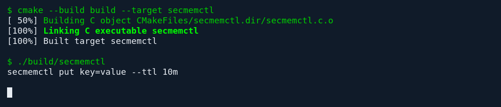
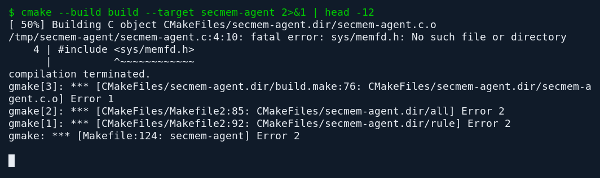

# SecMem Agent

В конкурсном прототипе агент принимает команды через Unix-сокет /run/secmem.sock. Исходники показывают работу с memfd, учётными данными клиента и libsodium. Ветка GET на стороне агента содержит незавершённую передачу файлового дескриптора.



*Сборка клиента и его подсказка по синтаксису*



*Результат сборки агента в Debian*

## Запуск

Требуются Linux, CMake, pkg-config, компилятор C и заголовки libsodium. Клиент можно собрать отдельно.

```bash
cmake -S . -B build
cmake --build build --target secmemctl
./build/secmemctl
```

## Что проверено

Клиент собран и вывел подсказку по команде put. Сборка агента в Debian 12 остановилась на sys/memfd.h. Хранение и выдача секретов не подтверждены, для реальных секретов эта версия непригодна.

## Авторство

Вячеслав Георгиевич Кузнецов. Сбертех, задание 3.
